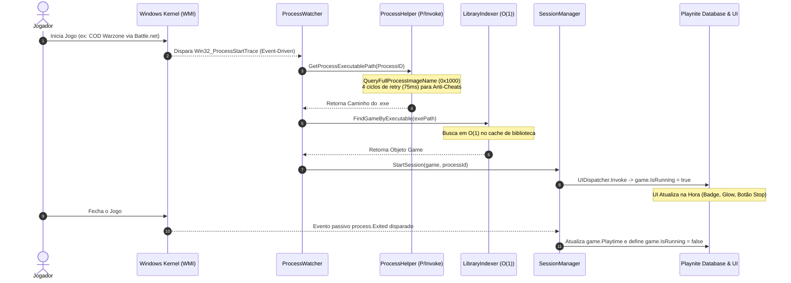

# ⏱️ External Game Tracker (Playnite Extension)

<p align="center">
  
</p>

<p align="center">
  <strong>Extensão inteligente e de alta performance para detecção e contabilização de jogos iniciados fora do Playnite.</strong>
</p>

<p align="center">
  <a href="https://playnite.link"></a>
  
  
  
  
</p>

---

## 🎯 Por Que Esta Extensão Existe?

Nativamente, o Playnite só reconhece que um jogo está em execução (`IsRunning = True`) e contabiliza o tempo de jogo se o jogo for disparado **de dentro do próprio Playnite**.

Se você abrir jogos diretamente por:
- Launchers de terceiros (**Battle.net**, Steam, Epic Games, Ubisoft Connect, Riot Client);
- Atalhos na área de trabalho ou menu iniciar;
- Comandos de voz, scripts ou overlays;

O Playnite permanece estático como se o jogo estivesse fechado, não calcula o tempo jogado e não ativa as animações ou estados do tema.

O **External Game Tracker** resolve isso de forma definitiva, com **zero consumo contínuo de CPU**, **sem loops de varredura** e com suporte completo a **jogos protegidos por anti-cheat**.

---

## 🏛️ Arquitetura e Engenharia



### 1. Zero-Polling WMI Kernel Trace (`ProcessWatcher.cs`)
Diferente de extensões que executam `Process.GetProcesses()` a cada poucos segundos (o que causa picos de consumo de CPU e impacta os frames de jogos pesados), o `ExternalGameTracker` utiliza o driver de rastreamento do kernel do Windows:
```sql
SELECT * FROM Win32_ProcessStartTrace
```
O Windows só acorda a extensão no exato milissegundo em que um novo processo é criado no sistema operacional. Em repouso, o consumo de processamento é **rigorosamente zero**.

### 2. Bypass de Permissão Anti-Cheat via P/Invoke (`ProcessHelper.cs`)
Jogos com anti-cheats em nível de kernel (como o **Ricochet** do Call of Duty, **Easy Anti-Cheat** ou **BattlEye**) bloqueiam a chamada padrão do .NET `process.MainModule` com erro `Win32Exception: Acesso Negado`.

Nossa implementação contorna esse bloqueio através da API nativa do Win32:
- Utiliza `OpenProcess` com a flag restrita `PROCESS_QUERY_LIMITED_INFORMATION (0x1000)`, concedida mesmo sob privilégios limitados.
- Executa `QueryFullProcessImageName` em um loop de retry assíncrono (4 tentativas a cada 75ms) para aguardar o bootstrapper inicializar antes do driver do anti-cheat bloquear a tabela de descritores.

### 3. Busca em Tempo Constante $O(1)$ (`LibraryIndexer.cs`)
Durante a inicialização do Playnite, a extensão varre a biblioteca de jogos instalados e normaliza os caminhos dos executáveis principais e subpastas comuns (`_retail_`, `Binaries/Win64`, `bin/x64`) em um `Dictionary<string, Game>` de alta performance. Quando um jogo abre, a identificação é imediata em $O(1)$, sem consultas ao disco.

### 4. Gerenciamento Thread-Safe de Sessões (`SessionManager.cs`)
- Armazena sessões ativas em uma `ConcurrentDictionary<Guid, ActiveSession>`.
- Inscreve-se no evento passivo `process.Exited`, garantindo que o Playnite seja notificado assim que o jogo for finalizado.
- Todos os disparos visuais e atualizações de banco de dados são despachados de forma segura para a thread principal da interface via `_playniteApi.MainView.UIDispatcher.Invoke()`.

---

## ⚙️ Configurações Disponíveis

Acesse as configurações em: **Playnite -> Extensões -> Configurações de Extensões -> External Game Tracker**.

1. **Tempo Mínimo de Sessão (Padrão: 15s):** Evita que launchers intermediários, atualizadores rápidos ou telas de splash contabilizem tempo indevidamente se forem fechados em poucos segundos.
2. **Varredura em Subpastas de 1º Nível:** Permite localizar automaticamente jogos cujos executáveis ficam dentro de subpastas como `_retail_` (Call of Duty, World of Warcraft) ou `Binaries/Win64`.
3. **Lista de Bloqueio (Blacklist):** Lista editável de executáveis que devem ser ignorados (ex: `steam.exe`, `Battle.net.exe`, `EpicGamesLauncher.exe`, `Discord.exe`).

---

## 🛠️ Menus Adicionados ao Playnite

A extensão adiciona ferramentas convenientes ao menu principal do Playnite:
- **Reescanear executáveis da biblioteca agora:** Força a reconstrução imediata do cache de executáveis na memória.
- **Ver processos de jogos ativos:** Exibe uma janela com o PID, executável e tempo decorrido de todas as sessões rastreadas no momento.
- **Diagnóstico do Jogo (Menu de Contexto do Jogo):** Clique com o botão direito em qualquer jogo da biblioteca para inspecionar quais executáveis a extensão associou àquele título.

---

## 💻 Compilação Manual

```powershell
cd extensions/ExternalGameTracker
dotnet restore
dotnet build -c Release
```
Para empacotar no formato de extensão do Playnite:
```powershell
& "$env:LOCALAPPDATA\Playnite\Toolbox.exe" pack "bin\Release" "..\..\releases"
```
